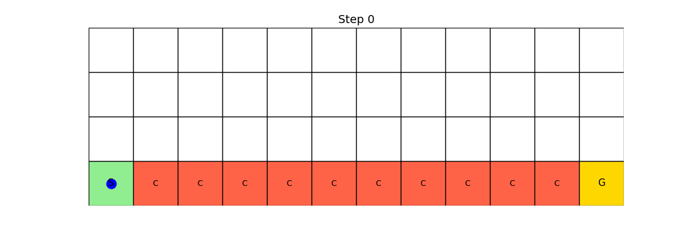
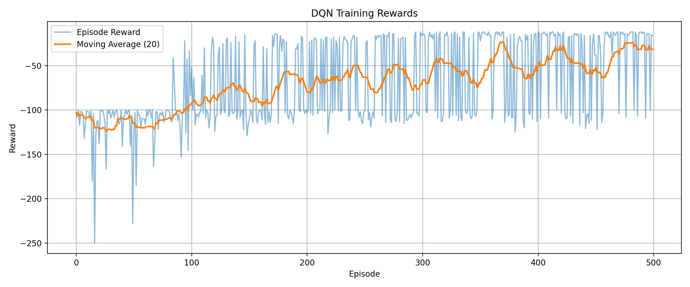

# Cliff Walking with a Deep Q-Network

A PyTorch agent learns to reach the goal in a custom Cliff Walking gridworld without stepping off the cliff. Instead of storing a table of state–action values, the agent uses a neural network to estimate the value of each possible move.

[Explore the implementation in the Jupyter notebook](./DQN_CliffWalking_DRL.ipynb).

## Learned policy

The animation shows the agent following its final policy in the gridworld.

## Training rewards

The plot shows how the agent’s episode reward changes over the course of training.

